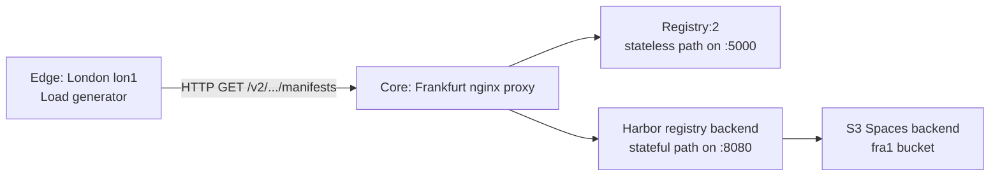

# OCI Image Registry Continuum: Performance Characterization & Resource Overhead

[](https://www.docker.com/)
[](https://goharbor.io/)
[](https://www.terraform.io/)
[](https://k6.io/)
[](https://www.python.org/downloads/)
[](https://opensource.org/licenses/MIT)
[](https://www.unibo.it)

**Course:** Infrastructures for Cloud Computing and Big Data M  
**Degree:** Master's Degree in Computer Engineering (*Corso di Laurea Magistrale in Ingegneria Informatica*)  
**Institution:** Alma Mater Studiorum – Università di Bologna (DISI)  
**Academic Year:** 2025/2026  
**Instructors:** Prof. Antonio Corradi, Prof. Andrea Sabbioni  
**Author:** Fabio Malagutti (Student ID: 0001247400)  

---

> 📄 **Full Technical Report:** Detailed experimental design, mathematical models, TCP buffer derivations, and complete benchmark analyses are published in [**`OCI_Registry_Continuum_Report.pdf`**](OCI_Registry_Continuum_Report.pdf).

---

## Project Abstract & Objectives

This repository documents a Master's degree experimental evaluation of OCI-compatible container registries deployed across a geo-distributed Cloud Continuum. The study compares a stateless registry path, implemented with Docker Distribution `Registry:2`, against a stateful enterprise path, implemented with Harbor and backed by S3 object storage, in order to quantify the operational cost of centralized control-plane services under edge-to-core WAN conditions.

The scientific focus is fourfold. First, the work isolates the so-called **Sidecar Tax**, namely the non-parallelizable latency and CPU overhead introduced by metadata-heavy control-plane logic such as authentication, authorization, and database-backed request handling. Second, it evaluates **Data Plane Offloading** through HTTP 307 redirects, showing how Harbor can preserve payload throughput by pushing blob delivery away from the control plane. Third, it studies the **L4 Bandwidth-Delay Product (BDP)** limit by constraining the Linux TCP window and observing the throughput plateau imposed by transport physics rather than application logic. Fourth, it demonstrates the **CAP-theorem consistency penalty**, measuring the replication lag introduced by synchronous, strongly consistent behavior compared with asynchronous, eventually consistent behavior across the WAN link.

The result is a reproducible environment that links theory, kernel tuning, reverse proxying, container orchestration, and k6-based load generation into a single end-to-end benchmark suite.

---

## Infrastructure Topology

The testbed spans two DigitalOcean regions to emulate a Cloud Continuum deployment with a realistic inter-region RTT of roughly 16 ms.

| Tier | Region | Public Role | Hardware | Software Stack |
| :--- | :--- | :--- | :--- | :--- |
| **Edge** | London (`lon1`) | Load generation and CAP-theorem simulation | 1 vCPU, 1.9 GiB RAM, x86_64, Ubuntu 6.8 kernel, Docker Engine 29.1.3 | `k6`, Bash orchestration scripts, Docker client tooling |
| **Core** | Frankfurt (`fra1`) | Registry hosting and reverse-proxy termination | 2 vCPUs, 3.8 GiB RAM, x86_64, Ubuntu 6.8 kernel, Docker Engine 29.1.3, Docker Compose 2.40.3 | `registry:2`, Harbor registry backend, NGINX, Docker Compose, TCP tuning scripts |

### Logical flow



The proxy keeps request buffering disabled on the Harbor path so that the backend, not the proxy, dominates the observable I/O profile. This is essential for measuring the sidecar tax and for making the payload benchmark reflect registry behavior rather than local buffering artifacts.

---

## Repository Structure

```text
.
├── README.md
├── OCI_Registry_Continuum_Report.pdf
├── deploy/
│   ├── core-frankfurt/
│   │   ├── config.yml            # Harbor registry storage backend configuration
│   │   ├── docker-compose.yml    # Core orchestration for Registry:2, Harbor, and NGINX
│   │   ├── nginx.conf            # Reverse proxy routes for stateless and stateful paths
│   │   └── tune_tcp.sh           # TCP buffer tuning for default and BDP-collapse tests
│   └── edge-london/
│       ├── runner.sh             # Baseline 3-run test orchestrator
│       ├── script_a_metadata.js  # k6 manifest/metadata benchmark
│       ├── script_b_payload.js   # k6 blob-download benchmark
│       └── simulate_cap.sh       # CP vs AP/BASE replication-latency demo
├── data/
│   ├── raw-k6/                   # Raw CSV outputs from k6 experiments
│   ├── telemetry/                # Host telemetry, environment reports, CAP results
│   └── processed-tables/         # Aggregated tables in CSV and LaTeX-ready text form
├── figures/                      # Derived charts used in the report
└── notebooks/
	└── registry_performance_analysis.ipynb
```

### Data subfolders

* `data/raw-k6/` contains the raw run outputs for metadata and payload workloads, including the baseline runs and the peak-stress tests.
* `data/telemetry/` contains host-level environment reports, CPU/RAM observations, and the CAP-theorem evidence file.
* `data/processed-tables/` contains the statistical summaries used to generate the report tables.

---

## Step-by-Step Deployment Guide: Core Node (Frankfurt)

### 1. Prerequisites

Prepare the Frankfurt node with Docker Engine, the Docker Compose plugin, and root access for TCP tuning. The core node must be reachable from the edge node on the public ports used by the proxy and registries.

Before starting the core stack, create an `.env` file in `deploy/core-frankfurt/` or export the required variables in your shell:

```bash
S3_BUCKET=<your-s3-bucket>
S3_ACCESS_KEY=<your-s3-access-key>
S3_SECRET_KEY=<your-s3-secret-key>
```

These values are consumed by `deploy/core-frankfurt/docker-compose.yml` when Harbor is started.

### 2. Configure the TCP stack

The `tune_tcp.sh` script is executed on the core node only. It adjusts Linux TCP buffer sizes to support two experimental regimes:

* `default` restores standard autotuning and is the baseline profile for normal throughput measurements.
* `collapse` constrains the buffers to 64 KB and is used to force the BDP experiment into a transport-layer bottleneck.

Run the baseline profile before the normal benchmark suite:

```bash
cd deploy/core-frankfurt
sudo ./tune_tcp.sh default
```

Run the collapse profile only when reproducing the BDP limit experiment:

```bash
cd deploy/core-frankfurt
sudo ./tune_tcp.sh collapse
```

### 3. Start the registry stack

Bring up the infrastructure with Docker Compose:

```bash
cd deploy/core-frankfurt
docker compose up -d
```

This starts the following services:

* `registry-standard` on the stateless data plane, exposed through the proxy on port `5000`
* `registry-harbor` on the stateful data plane, exposed through the proxy on port `8080`
* `proxy` as the NGINX front end that routes traffic to the appropriate backend

### 4. Verify the setup

Check that the containers are healthy and that the proxy ports are reachable before starting edge-side load generation.

```bash
docker ps
curl -I http://<core-ip>:5000/v2/
curl -I http://<core-ip>:8080/v2/
```

---

## Load Generation & Testing: Edge Node (London)

### 1. Baseline test suite

The baseline suite is orchestrated by `runner.sh`. It executes three runs and alternates metadata and payload requests across the stateless and stateful endpoints.

When using the command examples below, replace `<core-ip>` with the actual public IP address of your Frankfurt core node and `<digest>` with the SHA256 blob digest you intend to test.

```bash
cd deploy/edge-london
./runner.sh
```

The script writes CSV results into a local `results/` directory and uses the following target endpoints:

* `http://<core-ip>:5000` for the stateless Registry:2 path
* `http://<core-ip>:8080` for the Harbor path

### 2. Peak stress test at 500 VUs

The k6 workloads define staged load profiles by default. To bypass the stages and force a flat high-concurrency test, override the environment variables `VUS` and `DURATION`.

Metadata benchmark:

```bash
cd deploy/edge-london
k6 run -e TARGET_URL=http://<core-ip>:5000 -e VUS=500 -e DURATION=5m script_a_metadata.js
k6 run -e TARGET_URL=http://<core-ip>:8080 -e VUS=500 -e DURATION=5m script_a_metadata.js
```

Payload benchmark:

```bash
cd deploy/edge-london
k6 run -e TARGET_URL=http://<core-ip>:5000 -e BLOB_DIGEST=<digest> -e VUS=500 -e DURATION=5m script_b_payload.js
k6 run -e TARGET_URL=http://<core-ip>:8080 -e BLOB_DIGEST=<digest> -e VUS=500 -e DURATION=5m script_b_payload.js
```

Use the digest recorded in the repository’s test outputs or in `runner.sh`. The payload script streams the blob without retaining the body in client RAM so the measurement stays focused on throughput and server-side I/O behavior.

### 3. CAP-theorem simulation

The `simulate_cap.sh` helper demonstrates the latency difference between synchronous and asynchronous replication behavior by timing two push paths.

```bash
cd deploy/edge-london
./simulate_cap.sh
```

The script performs two conceptual checks:

* a CP-style push sequence that waits for the stronger consistency path
* an AP/BASE-style push sequence that completes with asynchronous replication semantics

---

## 🔬 Key Scientific Findings

* **PostgreSQL connection pool starvation dominates Harbor metadata latency.** The report shows a mean metadata latency of **80.56 ms** for Harbor versus **22.08 ms** for Registry:2, with the difference attributable to stateful control-plane work and queueing pressure in the metadata path.
* **The transport layer hits a physical BDP ceiling at roughly 54 MB/s.** When the TCP window is forced down to 64 KB, throughput plateaus at **54 MB/s**, confirming that the bottleneck is transport physics rather than registry implementation efficiency.
* **The CAP penalty is deterministic and tied to the WAN RTT.** The CP versus AP/BASE demonstration shows an approximately **16 ms** latency shift, matching the edge-to-core inter-region delay.
* **Harbor carries a static RAM tax that complicates bin packing.** The stateful architecture requires a larger baseline memory footprint and grows substantially under stress, whereas Registry:2 stays materially lighter on host resources.
* **Payload throughput converges when HTTP 307 offloading is used correctly.** Harbor matches Registry:2 at around **36.8 MB/s** for payload transfer, showing that data-plane offloading preserves heavy-layer throughput even when metadata processing is more expensive.

### Selected quantitative summary

| Configuration | Test Type | Mean Latency (ms) | p95 (ms) | p99 (ms) | Max Throughput (MB/s) | Success Rate |
| :--- | :--- | ---: | ---: | ---: | ---: | ---: |
| Registry:2 (SSD) | Metadata | 22.08 | 38.39 | 66.20 | - | 100.0% |
| Harbor (S3) | Metadata | 80.56 | 133.01 | 160.84 | - | 100.0% |
| Registry:2 (SSD) | Payload | 176.80 | 508.08 | 824.87 | 36.69 | 100.0% |
| Harbor (S3) | Payload | 101.15 | 143.04 | 239.47 | 36.80 | 100.0% |

---

## 📎 Reference Materials

* [Final report](OCI_Registry_Continuum_Report.pdf)
* [Processed IEEE-ready tables](data/processed-tables/)
* [Raw k6 outputs](data/raw-k6/)
* [Telemetry and environment reports](data/telemetry/)
* [Figures used in the analysis](figures/)

The repository is intended to be read together with the report. The scripts and data files provide the reproducibility layer; the PDF provides the formal methodology, hypotheses, and derivations.


